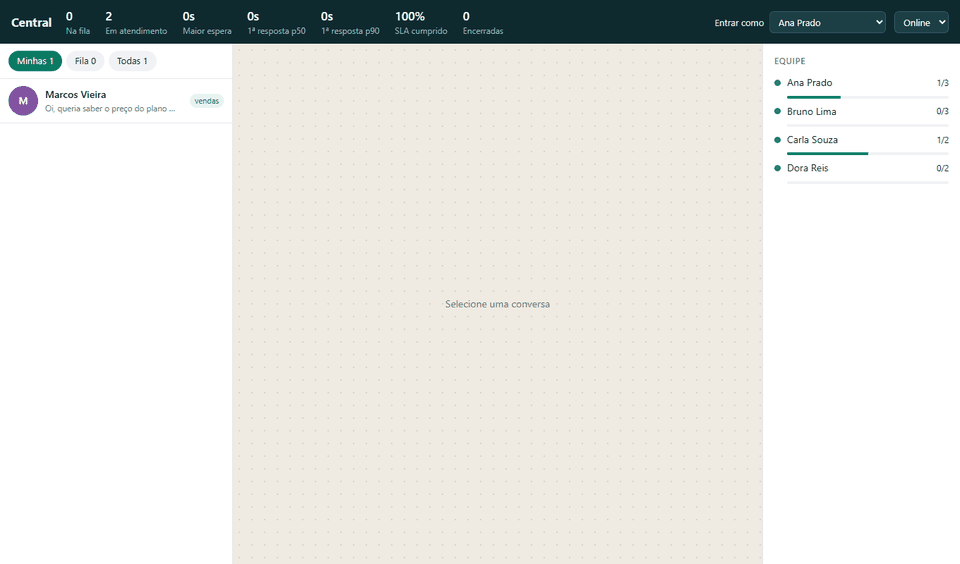
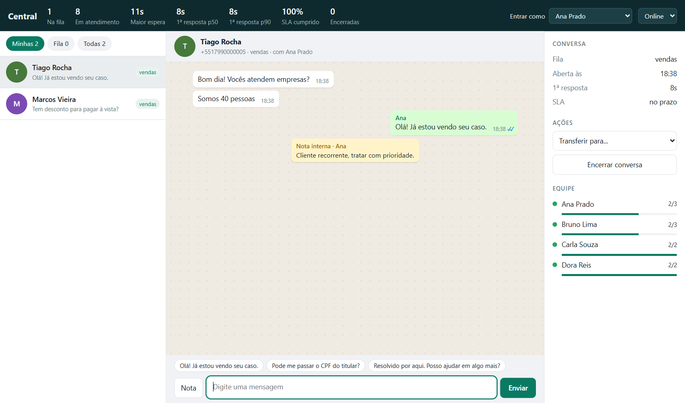
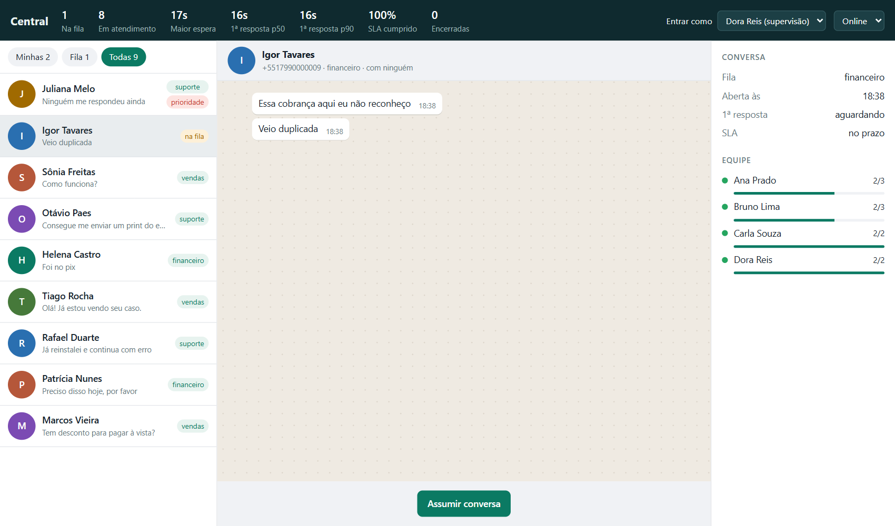
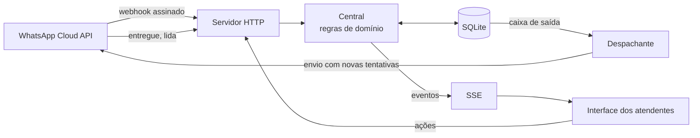

# Central de Atendimento

Caixa de entrada compartilhada para atender um número de WhatsApp com vários atendentes: filas, distribuição automática, posse exclusiva da conversa, SLA e supervisão ao vivo. TypeScript, Node 24, SQLite, zero dependências.

[](https://github.com/luizrenatodc/central-atendimento/actions/workflows/testes.yml)
[](LICENSE)



## O problema

Um único número de WhatsApp atendido por uma equipe gera sempre os mesmos erros: duas pessoas respondendo o mesmo cliente, conversa esquecida porque alguém saiu do turno, e nenhuma visão de quanto o cliente esperou. A central trata esses casos como regras do sistema, não como combinados da equipe.

| Tela do atendente | Tela da supervisão |
|---|---|
|  |  |

## Funcionalidades

| Área | O que faz |
|---|---|
| Triagem | Separa por fila (vendas, suporte, financeiro) e detecta urgência na primeira mensagem |
| Distribuição | Prioridade e antiguidade na fila; escolhe o habilitado com menor carga, respeitando a capacidade |
| Posse | Só um atendente assume cada conversa; supervisão pode intervir |
| Colaboração | Notas internas, respostas rápidas e transferência entre filas |
| Presença | Pausa mantém as conversas atuais; sair do ar as devolve à fila |
| SLA | Estouro da primeira resposta sobe a prioridade da conversa |
| Supervisão | Fila, espera, p50 e p90 da primeira resposta, SLA e carga da equipe em tempo real |

## Arquitetura



## Decisões técnicas

**Posse exclusiva por `UPDATE` condicional.** Assumir é `UPDATE ... WHERE estado = 'fila'`. Quem chega depois recebe "outra pessoa já assumiu", sem depender de checagem na interface.

**Caixa de saída transacional.** Responder grava a mensagem como pendente na mesma transação da regra de negócio. Um despachante faz o envio, então uma queda da plataforma não perde a resposta nem trava a tela do atendente.

**Ordem preservada na falha.** Se uma mensagem falha, as seguintes da mesma conversa esperam. As tentativas usam espera exponencial e, depois de cinco, a mensagem aparece como falha para o atendente.

**Webhook idempotente.** A plataforma reentrega eventos, então o id externo da mensagem é único no banco e a repetição é ignorada.

**Status que só avança.** Confirmações chegam fora de ordem. Um "entregue" atrasado não desfaz um "lida".

**Assinatura validada sobre o corpo cru.** O HMAC é calculado sobre os bytes recebidos e comparado em tempo constante. Reserializar o JSON mudaria o resultado.

**Janela de 24 horas como regra de domínio.** Fora da janela a plataforma só aceita modelos aprovados, e o sistema bloqueia o envio antes de tentar.

**SSE em vez de WebSocket.** O fluxo em tempo real é de mão única, e as ações já são HTTP. Cada evento leva um número de sequência, e o navegador retoma do último recebido ao reconectar.

**Índice parcial garante uma conversa ativa por telefone.** A regra fica no banco e vale mesmo se o código mudar.

## Como rodar

Requer Node 24 ou superior. Não há nada para instalar.

```bash
npm start     # http://localhost:3000, com clientes fictícios chegando
npm test      # 17 testes
```

Abra `/?a=ana`, `/?a=bruno` e `/?a=dora` em abas diferentes para ver a mesma operação por três perfis. Os clientes da demonstração entram pelo mesmo webhook assinado que a plataforma usaria.

## Testes

São 17 testes, com relógio e transporte injetados, cobrindo triagem, reentrega de webhook, distribuição por carga e habilidade, capacidade, prioridade, disputa pela mesma conversa, permissões, presença, transferência, janela de 24 horas, SLA, status fora de ordem, falha de envio com ordem preservada, retomada de eventos e assinatura.

A interface foi exercitada por um navegador automatizado em [`scripts/telas.mjs`](scripts/telas.mjs), que gera as imagens desta página. Essa passagem revelou um defeito que os testes de domínio não pegariam: a atualização em tempo real tirava o foco do campo de texto, e o Enter deixava de enviar. Foi corrigido, mas esse script não faz parte do CI.

## Estrutura

```text
src/central.ts        regras de fila, posse, SLA e envio
src/servidor.ts       HTTP, webhook, SSE
src/demonstracao.ts   clientes fictícios via webhook
public/               interface, sem framework
test/                 testes de domínio e de HTTP
```

## Limites conhecidos

- **Nunca foi ligado a um número real.** O webhook segue o formato documentado da Cloud API, mas só recebeu tráfego simulado, e o transporte de envio é um dublê. Faltam o `GET` de verificação do webhook e o cliente HTTP de envio.
- **Sem autenticação.** O atendente é identificado por um cabeçalho, o que serve para demonstração e não para produção. As regras de permissão existem, mas confiam nesse cabeçalho.
- **Só texto.** Mídia aparece como aviso de tipo recebido.
- **Modelos aprovados não estão implementados.** O sistema bloqueia o envio fora da janela, mas não oferece a alternativa.
- **Triagem por palavras-chave.** É simples de propósito, e `triar` é o ponto para um classificador.
- **Um processo.** Os eventos em tempo real ficam na memória do servidor. Com várias instâncias, seria preciso um barramento e um banco compartilhado.
- **SLA sem horário comercial.** O prazo corre 24 horas por dia.

## Sobre este projeto

Projeto de demonstração, com dados e clientes fictícios, criado para mostrar a abordagem técnica. Não tem relação com a Meta nem com o WhatsApp.

## Autor

**Luiz Renato Carvalho**, Engenheiro de Software e IA · [luizrenato.dev](https://www.luizrenato.dev) · [LinkedIn](https://linkedin.com/in/luizrenatodc)
